# MoodReach



**What drives the reach of a social media post: its mood, its timing, its place, or its author?** Team MoodReach, NYU Tandon Career Hub Data Science Bootcamp, Fall 2026, Section 2.

## Answer

On 99,999 real tweets (Jan–Apr 2016), the strongest signals of reach are **who posts** (follower count, Klout) and **how the post is written** (reply or not, mentions, hashtags, topic words). Mood is statistically detectable but practically negligible, and so is time of posting.

| Question | Method | Result |
|---|---|---|
| Q1 Can we read mood from text? | CountVectorizer / TF-IDF + MultinomialNB vs LogisticRegression | TF-IDF + LogisticRegression macro-F1 **0.81** (5-fold CV) vs 0.27 baseline; only 0.49 on human-labeled airline tweets, because the labels come from a word lexicon |
| Q2 Do positive and negative tweets get different retweets? | Welch t-test (+ Mann–Whitney) | p = 2e-11, retweet rate 21% vs 15%, but Cohen's d = **0.12** (negligible) |
| Q3 Is mood tied to the weekday? | Chi-square | p = 3e-14, Cramér's V = **0.031** (negligible) |
| Q4 How well can we predict retweets? | LinearRegression on log(1 + retweets) vs mean baseline | test R² **0.088** (5-fold 0.094 ± 0.020); adding words with Ridge gives 0.154 |
| Q4 Will a tweet be retweeted at all? | LogisticRegression | ROC AUC **0.72** with all features vs 0.52 with mood only |

Numbers come from [`Final/results.json`](Final/results.json), written by the notebook.

## Data

[Tweets and Engagement Metrics](https://huggingface.co/datasets/haoxianc/paakhim10_tweets-and-engagement-metrics) (MIT; Kaggle original by Paakhi Maheshwari): 102,062 tweets with text, lexicon sentiment score, RetweetCount, Reach, Klout, country, language, gender, weekday and hour. The notebook downloads it to `Final/data/`, which git ignores.

Cleaning decisions, each verified in the notebook:

- **Duplicates:** dropped 2,063 duplicate TweetIDs.
- **Clock:** the post time decoded from the Twitter ID shows that `Hour` is US Mountain time for every tweet.
- **Reshares:** these carry the original tweet's retweet count, so only original tweets are modeled.
- **Per-user cap:** one account earns 43% of all retweets. Each user is capped at 20 tweets, and train/test is split by user.

The midterm used a 732-row Kaggle set that looked synthetic. Section 1 of the final notebook shows why we left it.

## Contents

- `Final/final_analysis.ipynb`: the main analysis.
  - Section 0: cleaning.
  - Sections 1–2: data switch and EDA.
  - Section 3: sentiment classifier.
  - Section 4: hypothesis tests.
  - Section 5: engagement models and drivers.
  - Sections 6–7: bias–variance and limitations.
  - Section 8: summary.
- `Final/bonus_llm_finetune.ipynb`: an easter egg outside the course scope. Fine-tunes DistilBERT to predict "retweeted" from text (test AUC 0.76) and compares it with TF-IDF + LogisticRegression.
- `Final/bonus_laya_finetune.ipynb` + `Final/laya_gpu_job.py`: a second easter egg with [Laya](https://huggingface.co/convaiinnovations/laya), an open Jev-compatible decision model. Zero-shot it reads human-labeled airline mood at macro-F1 0.69 (our lexicon-trained classifier: 0.49). For reach it starts at a coin flip (AUC 0.50); one epoch of fine-tuning on text lifts it to 0.73. Adding the author card as JSON gave 0.70, below LogisticRegression on the same metadata (0.72).
- `Final/make_slides.py` → `Final/MoodReach_Final.pptx`: draft deck (7 slides + backup), built from `figures/` and `results.json`.
- `Final/figures/`: slide figures, numbered by notebook section.
- `Final/Investigation_Report.md`: requirements, dataset decision, plan and task split.
- `Midterm-presentation/`: midterm EDA, figures and slides (Oct 29).

## Reproduce

```bash
uv venv .venv && source .venv/bin/activate
uv pip install pandas numpy scipy scikit-learn matplotlib seaborn jupyter huggingface_hub python-pptx
cd Final
jupyter nbconvert --to notebook --execute --inplace final_analysis.ipynb   # ~3 min on a laptop
python make_slides.py
# optional bonus (needs torch + transformers, ~10 min on Apple-silicon GPU)
uv pip install torch transformers && jupyter nbconvert --to notebook --execute --inplace bonus_llm_finetune.ipynb
# optional Laya bonus: the notebook writes data/laya_job/, the GPU job (~3.7 h on an RTX 4060 laptop) writes predictions, then re-run the notebook
uv pip install laya && python laya_gpu_job.py --work data/laya_job --device cuda
```

## Team

Vince Pamolarco, John Yun, Siddharth Srivastava, Steven Li
